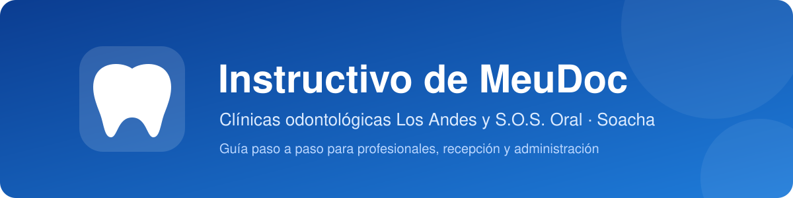

  

  
  
  
  

  <a href="docs/01-inicio-de-sesion.md"><b>Inicio de sesión</b></a> ·
  <a href="docs/02-profesional.md"><b>Profesional</b></a> ·
  <a href="docs/03-recepcionista.md"><b>Recepcionista</b></a> ·
  <a href="docs/04-administrador.md"><b>Administrador</b></a>

---

Esta guía es para el equipo de las clínicas odontológicas **Los Andes** y **S.O.S. Oral**. Explica cómo usar [MeuDoc](https://meudoc.co), la plataforma con la que se agendan citas, se registran pacientes, se envían recordatorios y se consultan los informes de las dos sedes.

Todo empieza en el inicio de sesión. Después, cada persona sigue la guía de su rol.

## 🚀 Empieza aquí

<table>
  <tr>
    <td align="center" width="25%">
      <h3>🔐</h3>
      <b>Inicio de sesión</b> 
      Para todo el equipo  
      Entrar, recuperar la contraseña y proteger la cuenta.  
      <a href="docs/01-inicio-de-sesion.md">Abrir guía →</a>
    </td>
    <td align="center" width="25%">
      <h3>🦷</h3>
      <b>Profesional</b> 
      Odontólogos y especialistas  
      Consultar las citas de su sede.  
      <a href="docs/02-profesional.md">Abrir guía →</a>
    </td>
    <td align="center" width="25%">
      <h3>📅</h3>
      <b>Recepcionista</b> 
      Recepción de cada sede  
      Agenda, pacientes, recordatorios, mensajes y reportes.  
      <a href="docs/03-recepcionista.md">Abrir guía →</a>
    </td>
    <td align="center" width="25%">
      <h3>⚙️</h3>
      <b>Administrador</b> 
      Dirección de la clínica  
      Todo lo de recepción más la configuración.  
      <a href="docs/04-administrador.md">Abrir guía →</a>
    </td>
  </tr>
</table>

## 🔑 Qué puede hacer cada rol

| Módulo | 🦷 Profesional | 📅 Recepcionista | ⚙️ Administrador |
|:---|:---:|:---:|:---:|
| Calendario | 👁️ Solo ve las citas de su sede | ✅ | ✅ |
| Crear, reprogramar o cancelar citas | ❌ | ✅ | ✅ |
| Bloqueos y recordatorios | ❌ | ✅ | ✅ |
| Pacientes | ❌ | ✅ | ✅ |
| Mensajes | ❌ | ✅ | ✅ |
| Reportes | ❌ | ✅ Los que habilite el administrador | ✅ Todos |
| Ajustes de su propia cuenta | ✅ | ✅ | ✅ |
| Agendas, servicios, cobros, usuarios y sedes | ❌ | ❌ | ✅ |
| Facturación electrónica | ❌ | ❌ | ✅ |

## 🧭 ¿Qué necesitas hacer?

| Tarea | Dónde está |
|:---|:---|
| Entrar por primera vez | [Inicio de sesión](docs/01-inicio-de-sesion.md#-antes-de-entrar-por-primera-vez) |
| Recuperar la contraseña | [Inicio de sesión](docs/01-inicio-de-sesion.md#-olvidé-mi-contraseña) |
| Ver las citas del día como profesional | [Profesional](docs/02-profesional.md#-ver-las-citas) |
| Registrar un paciente nuevo | [Recepcionista](docs/03-recepcionista.md#-registrar-un-paciente) |
| Agendar una cita | [Recepcionista](docs/03-recepcionista.md#-agendar-una-cita) |
| Reprogramar o cancelar una cita | [Recepcionista](docs/03-recepcionista.md#-reprogramar-o-cancelar-una-cita) |
| Programar un recordatorio por WhatsApp o correo | [Recepcionista](docs/03-recepcionista.md#-programar-un-recordatorio) |
| Escribirle a un paciente | [Recepcionista](docs/03-recepcionista.md#-mensajes) |
| Ver cuánto se facturó en el mes | [Recepcionista](docs/03-recepcionista.md#-reportes) |
| Invitar a una recepcionista o a un odontólogo | [Administrador](docs/04-administrador.md#-usuarios-y-permisos) |
| Cambiar el horario de un profesional | [Administrador](docs/04-administrador.md#-agendas-por-sede) |
| Crear o cambiar el precio de un servicio | [Administrador](docs/04-administrador.md#-servicios-por-sede) |

## 💬 Soporte

MeuDoc atiende por el chat de WhatsApp y web de su página, y por correo en comunicaciones@meudoc.co.

> [!NOTE]
> Si algo de esta guía ya no coincide con lo que ves en pantalla, puede que MeuDoc haya cambiado la interfaz. Avísale al administrador de la clínica para actualizar el instructivo.

## 📸 Sobre las imágenes

Las capturas se tomaron del portal real de la clínica en noviembre de 2026. Los nombres, teléfonos y correos de pacientes y del equipo aparecen difuminados.
