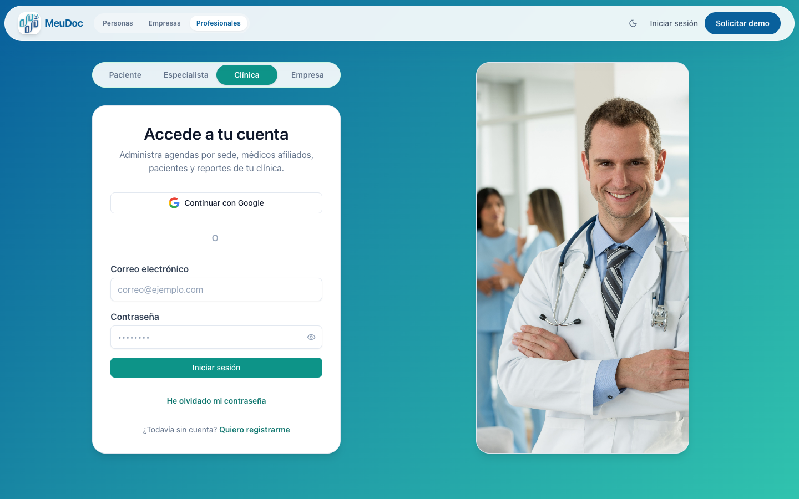
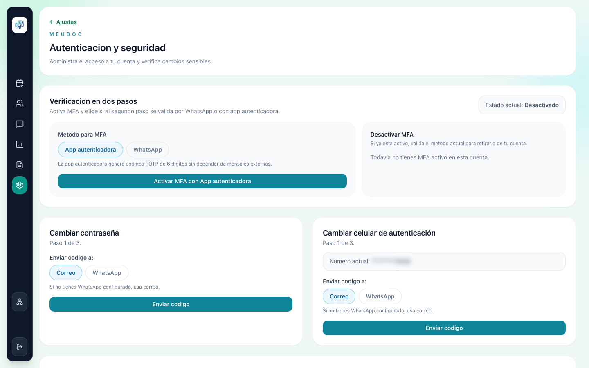

<a href="../README.md">🏠 Inicio</a> · <a href="02-profesional.md">Profesional →</a>

# 🔐 Inicio de sesión

Para todo el equipo: profesionales, recepción y administración.

**En esta guía**

- [Antes de entrar por primera vez](#-antes-de-entrar-por-primera-vez)
- [Entrar](#-entrar)
- [El menú](#-el-menú)
- [Olvidé mi contraseña](#-olvidé-mi-contraseña)
- [Cambiar la contraseña desde adentro](#-cambiar-la-contraseña-desde-adentro)
- [Verificación en dos pasos](#-verificación-en-dos-pasos)
- [Cerrar sesión](#-cerrar-sesión)

---

## 📨 Antes de entrar por primera vez

Nadie crea su propia cuenta de la clínica. El administrador te invita desde MeuDoc y te llega un correo con un enlace de un solo uso. Con ese enlace creas tu cuenta, o usas una que ya tengas con el mismo correo.

> [!TIP]
> Si el correo no llega, revisa la carpeta de spam. Si tampoco está ahí, pídele al administrador que reenvíe la invitación.

## 🚪 Entrar

1. Abre [meudoc.co/login](https://meudoc.co/login), o pulsa **Iniciar sesión** arriba a la derecha en [meudoc.co](https://meudoc.co).
2. Elige el tipo de cuenta en la fila de botones:

   | Botón | Quién lo usa |
   |:---|:---|
   | **Clínica** | Recepcionistas y administradores |
   | **Especialista** | Odontólogos y demás profesionales |
   | Paciente / Empresa | No se usan en la clínica |

3. Escribe tu **correo electrónico** y tu **contraseña**.
4. Pulsa **Iniciar sesión**. Si tu cuenta está ligada a Google, puedes usar **Continuar con Google**.

Al entrar, MeuDoc abre el **Calendario**.

> [!IMPORTANT]
> Si eliges el botón equivocado, MeuDoc no te deja entrar aunque la contraseña esté bien. Revisa que estés en **Clínica** o en **Especialista** según tu rol.

## 🧭 El menú

El menú es la barra oscura de la izquierda. Cada rol ve solo los módulos que le tocan.

| Ícono | Módulo | Qué hay ahí |
|:---:|:---|:---|
| 📅 | Calendario | Agenda semanal de las sedes |
| 👥 | Pacientes | Lista y fichas de pacientes |
| 💬 | Mensajes | Conversaciones con pacientes |
| 📊 | Reportes | Citas, ingresos, gastos y eficiencia |
| 🧾 | Facturación | Facturación electrónica |
| ⚙️ | Ajustes | Tu cuenta y la configuración de la clínica |
| 🔗 | MeuRed | Red de profesionales de MeuDoc |
| ↪️ | Cerrar sesión | Al final de la barra |

## 🔄 Olvidé mi contraseña

1. En la pantalla de inicio de sesión pulsa **He olvidado mi contraseña**.
2. Escribe tu correo.
3. Abre el enlace que te llega y crea una contraseña nueva.

## 🔁 Cambiar la contraseña desde adentro

1. Ve a **Ajustes** → **Autenticación**.
2. En **Cambiar contraseña**, elige si quieres el código por **Correo** o por **WhatsApp**.
3. Pulsa **Enviar código**.
4. Escribe el código y luego la contraseña nueva.

## 🔒 Verificación en dos pasos

Es opcional, pero conviene activarla porque la cuenta tiene datos de salud de los pacientes.

1. Ve a **Ajustes** → **Autenticación**.
2. En **Método para MFA**, elige **App autenticadora** o **WhatsApp**.
3. Pulsa **Activar MFA** y sigue los pasos.

<b>¿Cómo cambio el celular de autenticación?</b>

 

En la misma pantalla, busca **Cambiar celular de autenticación**. MeuDoc te manda un código a tu correo o a tu WhatsApp actual. Cuando lo confirmas, escribes el número nuevo en formato internacional, por ejemplo `+57 300 000 0000`.

## 👋 Cerrar sesión

Pulsa la flecha de salida al final del menú.

> [!WARNING]
> En el computador de recepción, cierra sesión cada vez que te levantes del puesto. Cualquiera que lo use puede ver los datos de los pacientes.

---

<a href="../README.md">🏠 Inicio</a> · <a href="02-profesional.md">Guía del profesional →</a>

