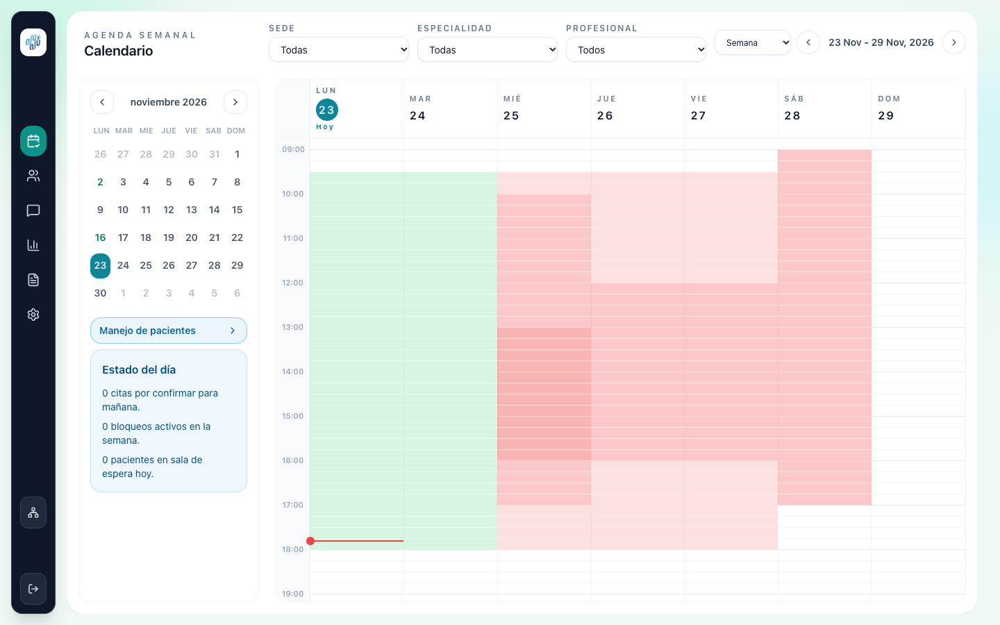

<a href="01-inicio-de-sesion.md">← Inicio de sesión</a> · <a href="../README.md">🏠 Inicio</a> · <a href="03-recepcionista.md">Recepcionista →</a>

# 🦷 Guía del profesional

Para odontólogos y especialistas de Los Andes y S.O.S. Oral.

> [!NOTE]
> El profesional **solo consulta** el calendario. Ve las citas de la sede donde atiende y no puede crearlas, moverlas ni cancelarlas. Esos cambios los hace recepción.

**En esta guía**

- [Entrar](#-entrar)
- [Ver las citas](#-ver-las-citas)
- [Qué significan los colores](#-qué-significan-los-colores)
- [Si algo está mal en tu agenda](#-si-algo-está-mal-en-tu-agenda)

---

## 🚪 Entrar

1. Abre [meudoc.co/login](https://meudoc.co/login).
2. Elige **Especialista**.
3. Escribe tu correo y tu contraseña.
4. Pulsa **Iniciar sesión**.

Lo de contraseñas y verificación en dos pasos está en la guía de [Inicio de sesión](01-inicio-de-sesion.md).

## 📅 Ver las citas

El calendario abre en la semana actual.

| Para… | Haz esto |
|:---|:---|
| Cambiar de semana o de día | Usa las flechas **‹ ›** junto a la fecha, arriba a la derecha |
| Ir a una fecha concreta | Pulsa el día en el calendario pequeño de la izquierda |
| Cambiar la vista | En el selector de arriba elige **Semana**, **Día** o **Agenda** |
| Ver los detalles de una cita | Pulsa la cita: verás paciente, servicio, hora y duración |

> [!TIP]
> La vista **Agenda** muestra el día como una lista por horas. Es la más cómoda para revisar la jornada antes de empezar.

## 🎨 Qué significan los colores

| Color | Significado |
|:---:|:---|
| 🟩 Verde | Horario de atención disponible |
| 🟥 Rojo | Fuera de horario o bloqueado |

## 🔧 Si algo está mal en tu agenda

Tu horario, tus servicios y tus tarifas los configura la clínica. Pídele a recepción o al administrador que:

- corrija una cita mal agendada,
- bloquee un espacio en el que no vas a atender,
- ajuste tu horario si no coincide con el real.

---

<a href="01-inicio-de-sesion.md">← Inicio de sesión</a> · <a href="../README.md">🏠 Inicio</a> · <a href="03-recepcionista.md">Guía de recepción →</a>

