
<a href="02-profesional.md">← Profesional</a> · <a href="../README.md">🏠 Inicio</a> · <a href="04-administrador.md">Administrador →</a>

# 📅 Guía de la recepcionista

Para el personal de recepción de Los Andes y S.O.S. Oral.

> [!NOTE]
> Recepción puede hacer todo el trabajo del día a día: calendario, pacientes, mensajes y reportes. Lo único que no ve es la configuración de la clínica, que es del administrador.

**En esta guía**

1. [Entrar](#-entrar)
2. [El calendario](#-el-calendario)
3. [Registrar un paciente](#-registrar-un-paciente)
4. [Agendar una cita](#-agendar-una-cita)
5. [Reprogramar o cancelar una cita](#-reprogramar-o-cancelar-una-cita)
6. [Bloquear un espacio](#-bloquear-un-espacio)
7. [Programar un recordatorio](#-programar-un-recordatorio)
8. [Manejo de pacientes del día](#-manejo-de-pacientes-del-día)
9. [La ficha del paciente](#-la-ficha-del-paciente)
10. [Mensajes](#-mensajes)
11. [Reportes](#-reportes)
12. [Ajustes de tu cuenta](#-ajustes-de-tu-cuenta)

---

## 🚪 Entrar

1. Abre [meudoc.co/login](https://meudoc.co/login).
2. Elige **Clínica**.
3. Escribe tu correo y tu contraseña y pulsa **Iniciar sesión**.

Más detalles en [Inicio de sesión](01-inicio-de-sesion.md).

## 📆 El calendario

Es la pantalla principal. Muestra la semana de todas las sedes y todos los profesionales.

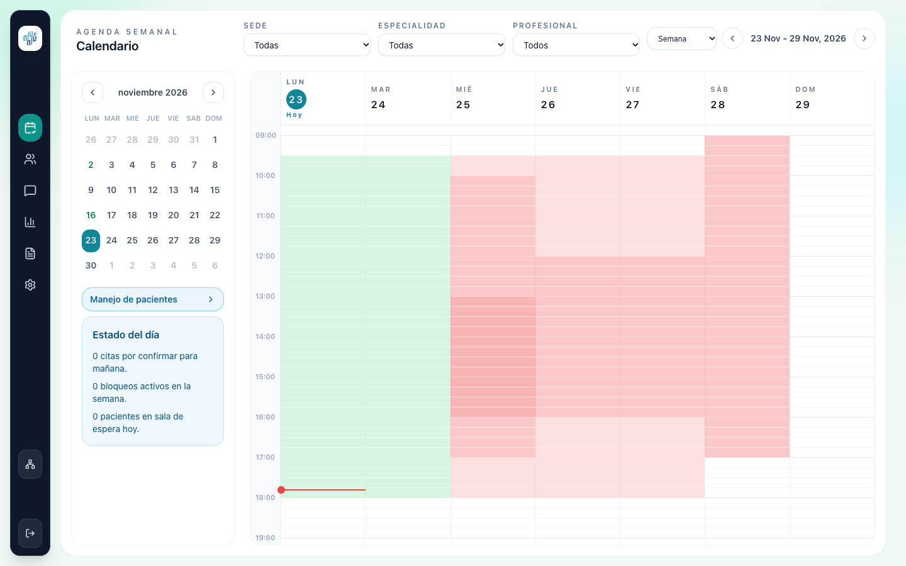

| Parte | Para qué sirve |
|:---|:---|
| **Sede** | Ver solo Los Andes, solo S.O.S. Oral o las dos |
| **Especialidad** | Filtrar por Endodoncia, Odontología u Ortodoncia |
| **Profesional** | Ver la agenda de un solo profesional |
| **Semana / Día / Agenda** | Cambiar la vista |
| Flechas **‹ ›** | Pasar a la semana o al día anterior o siguiente |
| Calendario pequeño | Saltar a una fecha |
| **Estado del día** | Citas por confirmar para mañana, bloqueos de la semana y pacientes en sala de espera |

Las franjas 🟩 verdes son horario disponible. Las 🟥 rojas están fuera de horario o bloqueadas.

## 👤 Registrar un paciente

Hazlo antes de agendar si el paciente es nuevo. También puedes hacerlo desde la misma cita con **+ Añadir paciente**.

1. En el menú, abre **Pacientes**.
2. Pulsa **Agregar paciente**, arriba a la derecha.
3. Llena el formulario:

   | Campo | Obligatorio | Nota |
   |:---|:---:|:---|
   | Sede del paciente | ✅ | Los Andes o S.O.S. Oral |
   | Nombre | ✅ | |
   | Apellidos | ✅ | |
   | Teléfono | | Con indicativo. Lo usa MeuDoc para WhatsApp y recordatorios |
   | Email | | Para notificaciones y documentos |
   | + Agregar otro teléfono | | Por ejemplo, el de un acudiente |
   | Tipo de paciente | | Privado o De aseguradora |

4. Pulsa **Guardar**. Si el paciente no dio datos de contacto, usa **Guardar sin datos de contacto**.

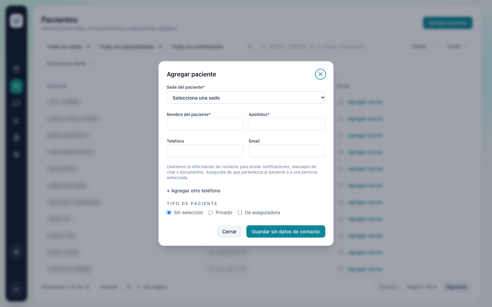

> [!IMPORTANT]
> Confirma que el teléfono y el correo sean del paciente o de alguien autorizado por él. MeuDoc les manda recordatorios y mensajes.

<b>Buscar y filtrar pacientes</b>

 

En **Pacientes** puedes:

- buscar por nombre, teléfono, documento o número de paciente,
- filtrar por sede, especialidad o profesional,
- usar **Controla los datos** para ver solo los pacientes con datos **Completos** o **Incompletos**,
- pulsar **Agregar correo** en la fila de un paciente que no tenga correo,
- cambiar cuántos pacientes ves por página (5, 12, 20 o 30).

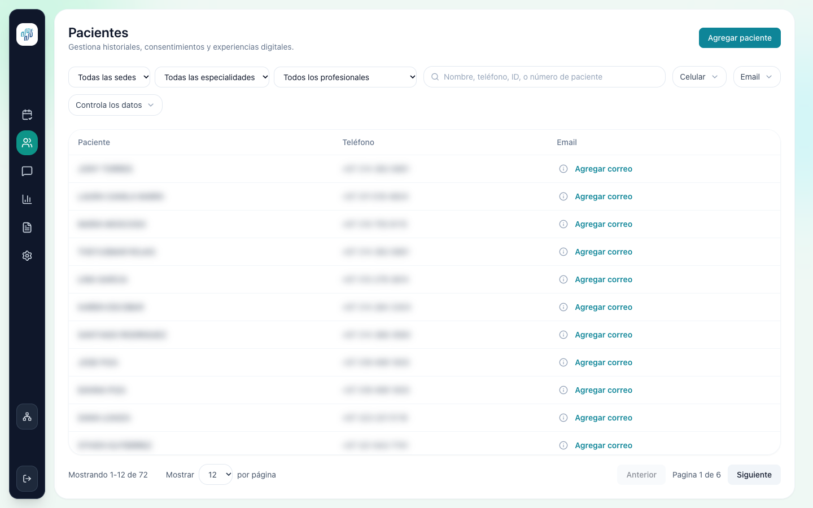

## ➕ Agendar una cita

1. En el **Calendario**, pulsa el espacio libre en el día y la hora de la cita. En la vista **Agenda** también puedes pulsar **+ Crear cita** junto a la hora.
2. Se abre un panel a la derecha en la pestaña **Cita**.
3. En **Paciente**, búscalo por nombre o teléfono. Si no existe, pulsa **+ Añadir paciente**.
4. Revisa los **Detalles**:

   | Campo | Qué poner |
   |:---|:---|
   | Fecha y Hora | Ya vienen del espacio que pulsaste. Puedes cambiarlas |
   | Repetir | **No repetir**, o **Personalizado** para citas periódicas como controles |
   | Agenda | El profesional que atiende |
   | Servicio | El tratamiento. Llena solo la duración y el precio |
   | + Agregar otro servicio | Si en la misma cita se hacen dos cosas, por ejemplo limpieza y resina |
   | Duración y Precio | Ajústalos si este caso es distinto al estándar |

5. Si quieres, abre **Pago** para registrar si ya pagó, **Notas** para dejar un comentario y **Notificaciones** para elegir los avisos al paciente.
6. Pulsa **Crear cita**.

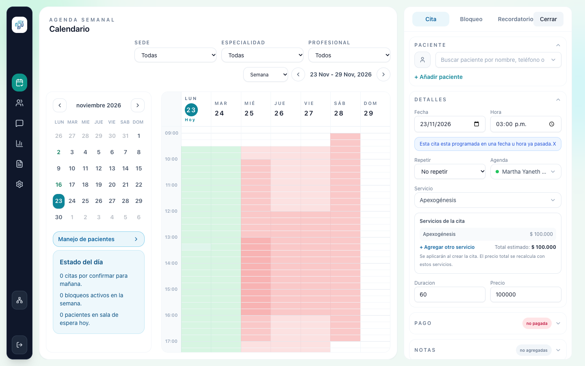

> [!WARNING]
> Si aparece *"Esta cita está programada en una fecha u hora ya pasada"*, revisa la fecha antes de guardar.

## 🔄 Reprogramar o cancelar una cita

1. En el **Calendario**, pulsa la cita.
2. Para **reprogramar**, cambia la fecha, la hora o el profesional y guarda. La cita queda en el mismo registro, con su historial.
3. Para **cancelar**, usa la opción de cancelar dentro de la cita.

> [!TIP]
> Reprograma siempre sobre la misma cita en vez de borrarla y crear otra. Así los reportes de cancelaciones y ausencias quedan bien.

## ⛔ Bloquear un espacio

Sirve cuando un profesional no va a atender: una incapacidad, una reunión o un festivo.

1. Pulsa el espacio en el calendario.
2. En el panel, cambia a la pestaña **Bloqueo**.
3. Elige las **Agendas** a las que aplica.
4. Pon **Fecha inicio**, **Hora inicio**, **Fecha fin** y **Hora fin**.
5. Pulsa **Crear bloqueo**.

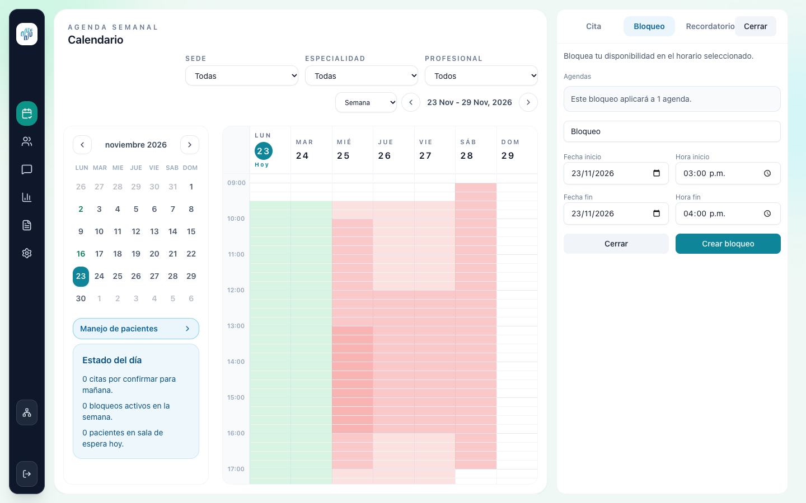

## 🔔 Programar un recordatorio

1. Pulsa el espacio en el calendario.
2. Cambia a la pestaña **Recordatorio**.
3. Pon la **Fecha de envío** y la **Hora de envío**.
4. Elige el **Paciente**. Es opcional.
5. Elige el **Canal**: **Email** o **WhatsApp**.
6. Escribe el **Mensaje** y pulsa **Programar recordatorio**.

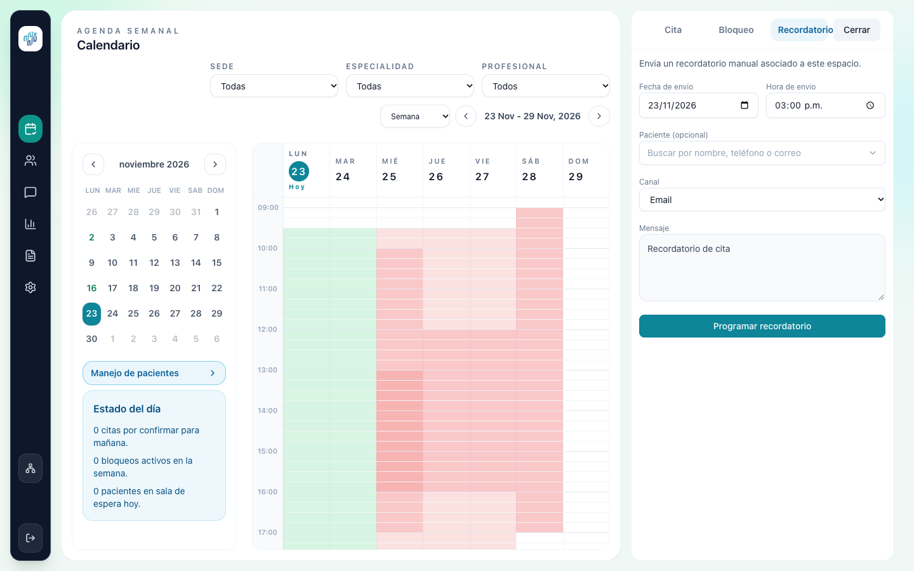

## 🏥 Manejo de pacientes del día

En el **Calendario**, pulsa **Manejo de pacientes**, debajo del calendario pequeño. Se abre un tablero con el estado de cada cita de hoy:

| Columna | Significado |
|:---|:---|
| **Programadas** | Citas de hoy que aún no llegan |
| **Sala de espera** | El paciente ya llegó |
| **Visita en curso** | Está en consulta |
| **No vino** | No asistió |
| **Realizadas** | La consulta terminó |
| **Canceladas** | Se canceló |

La pestaña **Confirmaciones de mañana** muestra las citas del día siguiente que faltan por confirmar.

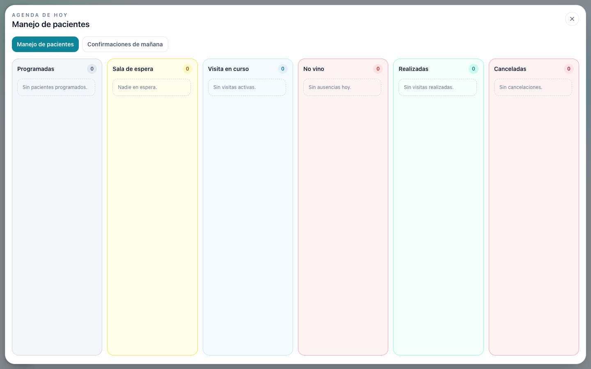

## 📋 La ficha del paciente

En **Pacientes**, pulsa el nombre de un paciente.

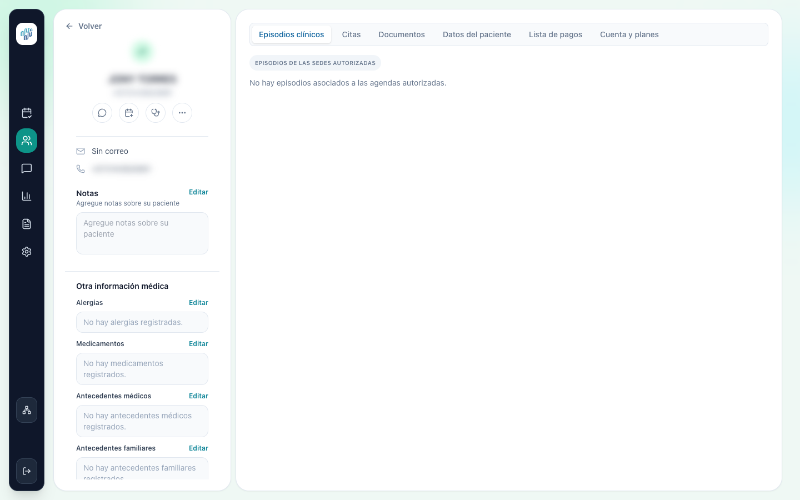

- **A la izquierda** están sus datos de contacto, unos botones rápidos para escribirle o agendarle, las **Notas** y la **Otra información médica**: alergias, medicamentos, antecedentes médicos, antecedentes familiares y otros.
- **A la derecha** hay pestañas:

  | Pestaña | Qué tiene |
  |:---|:---|
  | Episodios clínicos | Los episodios de atención en las sedes autorizadas |
  | Citas | Todas sus citas, pasadas y futuras |
  | Documentos | Archivos del paciente |
  | Datos del paciente | Información personal para editar |
  | Lista de pagos | Lo que ha pagado |
  | Cuenta y planes | Saldo a favor, paquetes y planes por cuotas |

## 💬 Mensajes

1. En el menú, abre **Mensajes**.
2. Para empezar una conversación, en **Nueva conversación** elige la sede y busca al paciente.
3. Para seguir una conversación, pulsa el nombre del paciente en la lista.

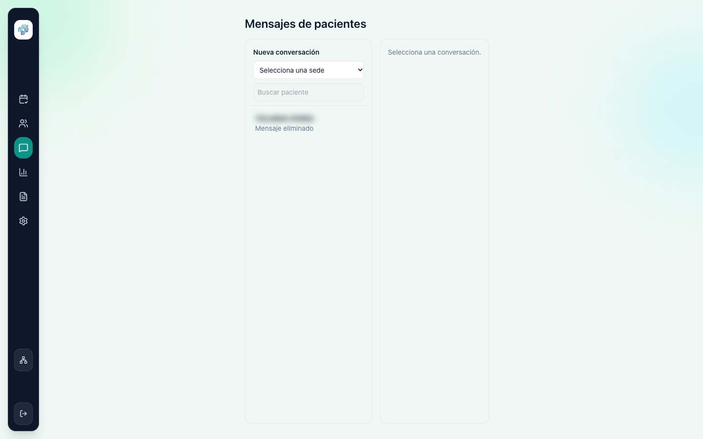

> [!NOTE]
> El paciente necesita un teléfono o un correo registrado. Si MeuDoc no te deja enviar, pídele al administrador que revise tus permisos.

## 📊 Reportes

En el menú, abre **Reportes**. Verás los informes que el administrador te haya habilitado.

| Informe | Qué muestra |
|:---|:---|
| **Reservas y reputación** | Reservas del periodo, reservas en línea, visitas al perfil y calificaciones |
| **Eficiencia** | Citas realizadas, ingresos estimados, ausencias, cancelaciones y servicios más pedidos |
| **Informe de citas** | Total de citas, completadas, canceladas y facturado, con el detalle de cada cita |
| **Informe de ingresos** | Pagado, pendiente, reembolsado y tasa de recaudo |
| **Control de gastos** | Gastos de la clínica |

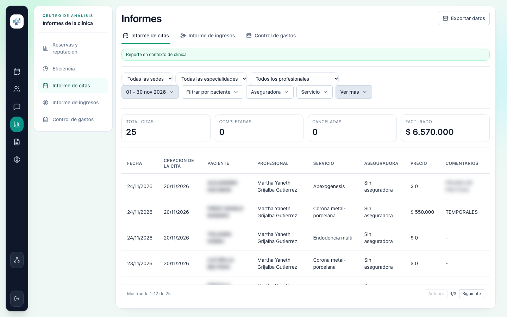

**Para usar cualquier informe:**

1. Filtra por **Sede**, **Especialidad** o **Profesional**.
2. Cambia el rango de fechas en el botón de fechas.
3. Usa **Filtrar por paciente**, **Aseguradora**, **Servicio** o **Ver más** si necesitas algo más fino.
4. Pulsa **Exportar datos** para descargar la tabla.

<b>Registrar un gasto</b>

 

1. En **Reportes** → **Control de gastos**, pulsa **Agregar gasto**.
2. Llena **Concepto**, **Categoría** (Administrativo o Insumos médicos), la sede, una **Descripción** si hace falta, el **Importe**, la **Fecha de pago** y el **Estado de pago**.
3. Pulsa **Agregar gasto**.

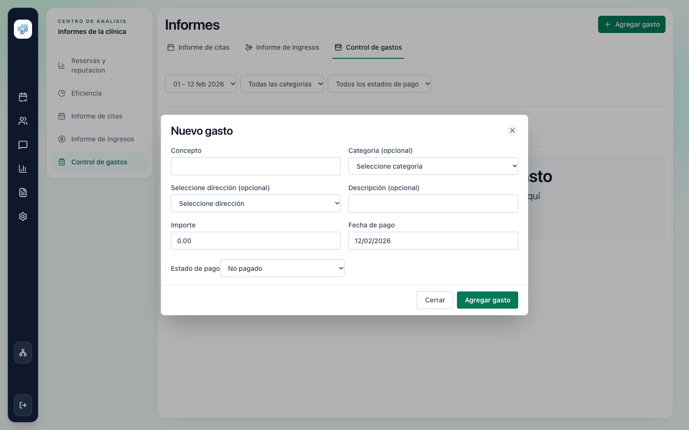

<b>Ver el informe de ingresos</b>

 

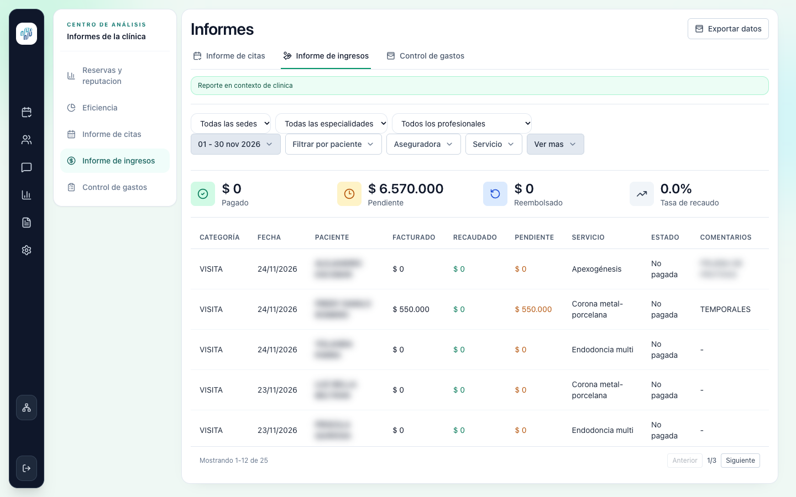

## 🔧 Ajustes de tu cuenta

En **Ajustes** → **Mi cuenta** tienes:

| Opción | Para qué |
|:---|:---|
| **Preferencias** | Modo claro u oscuro, avisos por correo o WhatsApp, idioma y zona horaria |
| **Autenticación** | Contraseña, verificación en dos pasos y celular de autenticación |
| **Descargar citas** | Bajar un archivo CSV con las citas de una sede entre dos fechas |

<b>Ver las pantallas de Preferencias y Descargar citas</b>

 

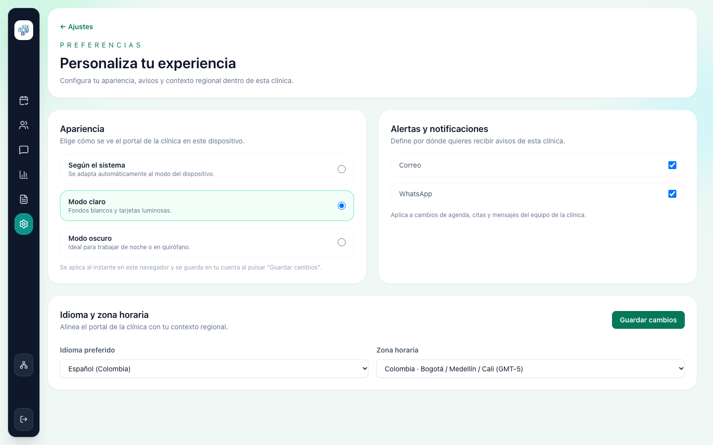

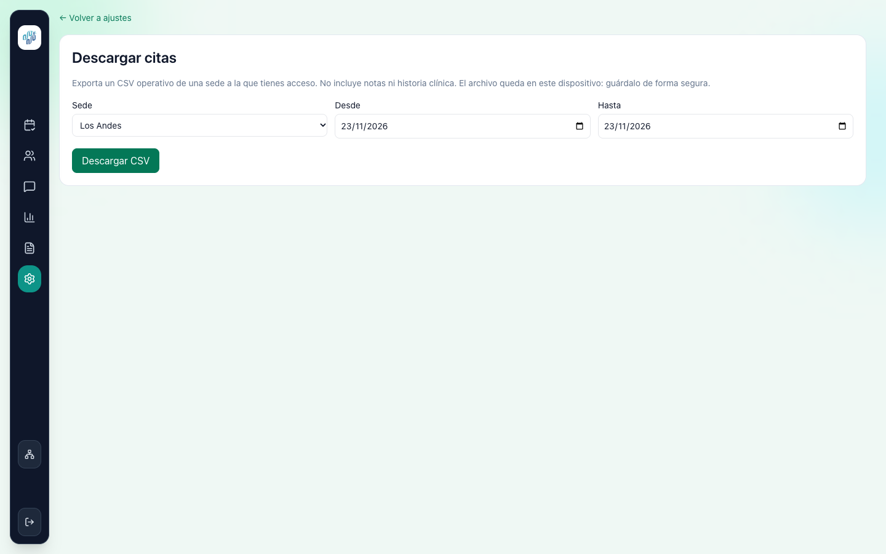

> [!WARNING]
> El CSV de citas no trae notas ni historia clínica, pero sí datos de pacientes. Guárdalo en un lugar seguro y bórralo cuando ya no lo necesites.

---

<a href="02-profesional.md">← Profesional</a> · <a href="../README.md">🏠 Inicio</a> · <a href="04-administrador.md">Guía del administrador →</a>

