
<a href="03-recepcionista.md">← Recepcionista</a> · <a href="../README.md">🏠 Inicio</a>

# ⚙️ Guía del administrador

Para la dirección y los administradores de Los Andes y S.O.S. Oral.

> [!NOTE]
> El administrador puede hacer todo lo de la [guía de recepción](03-recepcionista.md) y además configura la clínica: agendas, servicios, cobros, usuarios, sedes y facturación. Esta guía cubre solo esa parte extra.

**En esta guía**

1. [Entrar](#-entrar)
2. [El menú de Ajustes](#-el-menú-de-ajustes)
3. [Usuarios y permisos](#-usuarios-y-permisos)
4. [Agendas por sede](#-agendas-por-sede)
5. [Servicios por sede](#-servicios-por-sede)
6. [Cobros y paquetes](#-cobros-y-paquetes)
7. [Sedes](#-sedes)
8. [Perfil de la clínica](#-perfil-de-la-clínica)
9. [Diseños de impresión](#-diseños-de-impresión)
10. [Facturación electrónica](#-facturación-electrónica)
11. [Reportes completos](#-reportes-completos)
12. [Buenas prácticas](#-buenas-prácticas)

---

## 🚪 Entrar

1. Abre [meudoc.co/login](https://meudoc.co/login).
2. Elige **Clínica**.
3. Escribe tu correo y tu contraseña y pulsa **Iniciar sesión**.

Más detalles en [Inicio de sesión](01-inicio-de-sesion.md).

## 🧩 El menú de Ajustes

En el menú, abre **Ajustes**. La pantalla tiene dos bloques:

- **Mi cuenta**: Preferencias, Autenticación y Descargar citas. Es lo mismo que ve recepción.
- **Administración de la clínica**: todo lo que se explica abajo.

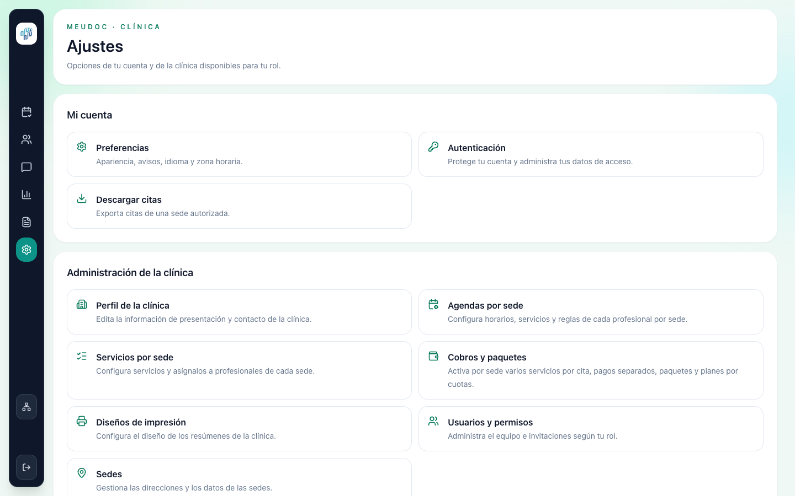

## 👥 Usuarios y permisos

Aquí se maneja quién entra a MeuDoc y qué ve. La pantalla tiene tres pestañas: **Equipo administrativo**, **Médicos** e **Invitaciones**.

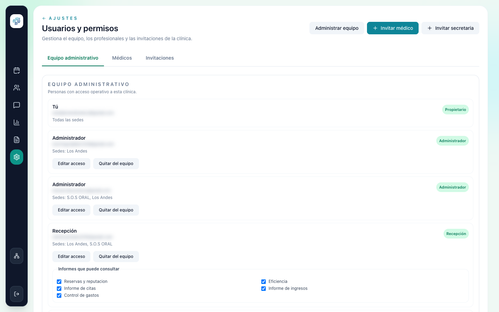

### Invitar a una recepcionista

1. Pulsa **Invitar secretaria**.
2. Escribe el **correo** de la persona.
3. Marca las **sedes** cuyo calendario va a manejar.
4. Pulsa **Enviar invitación**.

Le llega un enlace de un solo uso para crear su cuenta.

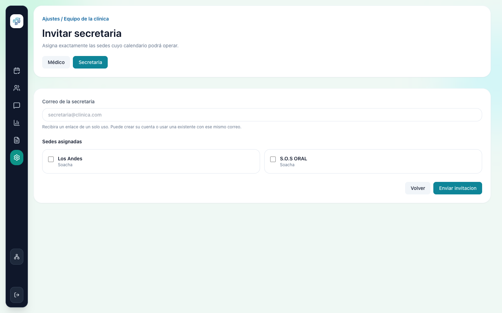

### Invitar a un profesional

1. Pulsa **Invitar médico**.
2. Elige la **sede**. Su agenda queda ligada a esa sede.
3. Marca los **servicios** que va a atender. Puedes usar **Buscar servicio**.
4. Escribe su correo y envía la invitación.

Cuando el profesional acepta, MeuDoc le crea la agenda con esos servicios.

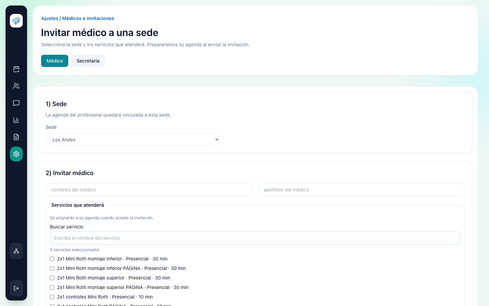

### Cambiar el acceso de alguien

1. Busca a la persona en **Equipo administrativo** y pulsa **Editar acceso**.
2. Elige el **Rol**:

   | Rol | Qué puede hacer |
   |:---|:---|
   | **Owner** | Dueño de la cuenta. Todo, en todas las sedes |
   | **Admin** | Todo, en las sedes que tenga autorizadas |
   | **Secretaria** | Trabajo de recepción, sin configuración |

3. Marca las **Sedes autorizadas**.
4. Pulsa **Guardar**.

Para las recepcionistas, debajo de su nombre aparece **Informes que puede consultar**. Marca o desmarca cada informe: Reservas y reputación, Eficiencia, Informe de citas, Informe de ingresos y Control de gastos.

> [!CAUTION]
> Cuando alguien deja de trabajar en la clínica, pulsa **Quitar del equipo** ese mismo día. Mientras siga en la lista puede entrar y ver los datos de los pacientes.

## 📆 Agendas por sede

Cada profesional tiene una agenda por cada sede donde atiende. La clínica configura la agenda y el profesional solo la consulta.

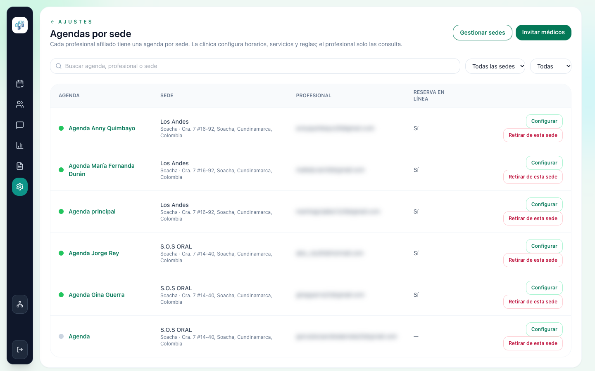

- La tabla muestra cada agenda con su sede, el profesional y si acepta **reserva en línea**.
- Filtra por sede o por estado (activas o inactivas) y usa **Buscar agenda**.
- **Retirar de esta sede** quita al profesional de esa sede.
- En **Cupos sin profesional** están los espacios de agenda libres. Pulsa **Invitar profesional** para asignarle uno a alguien.

### Configurar una agenda

Pulsa **Configurar** en la agenda. Arriba hay pestañas: **Horarios**, **Información**, **Servicios**, **Pagos**, **Consulta en línea**, **Reserva online**, **Comunicaciones** y **Agenda diaria**.

**Para cambiar el horario de atención:**

1. Abre la pestaña **Horarios**.
2. En cada día, elige la hora de inicio y la de fin.
3. Con **Ajustar opciones** defines si la franja se ve en el perfil público, la duración de cada cita y si es solo para pacientes privados.
4. Usa **+ Agregar otro horario de trabajo** si el profesional tiene dos franjas el mismo día, por ejemplo mañana y tarde.
5. **Eliminar** quita una franja.
6. Guarda los cambios.

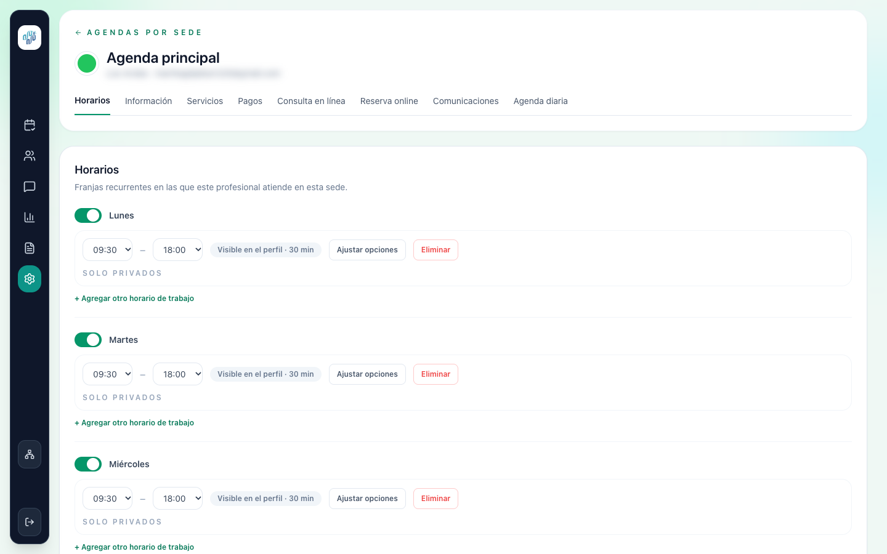

## 🦷 Servicios por sede

Cada servicio se crea una vez por sede y luego se asigna a los profesionales que lo hacen.

**Crear un servicio:**

1. Elige la **Sede**.
2. Pulsa **Agregar servicio**.
3. Llena **Nombre**, **Modalidad** (Presencial o Virtual), **Duración en minutos**, **Precio base (COP)** y **Descripción**.
4. Pulsa **Guardar**.

**Asignarlo a profesionales:**

1. Busca el servicio en la lista.
2. En **Selecciona uno o varios profesionales**, marca a quienes lo ofrecen.
3. Si alguno cobra distinto, escribe la **Tarifa para seleccionados**.
4. Pulsa **Asignar o cambiar tarifa**.

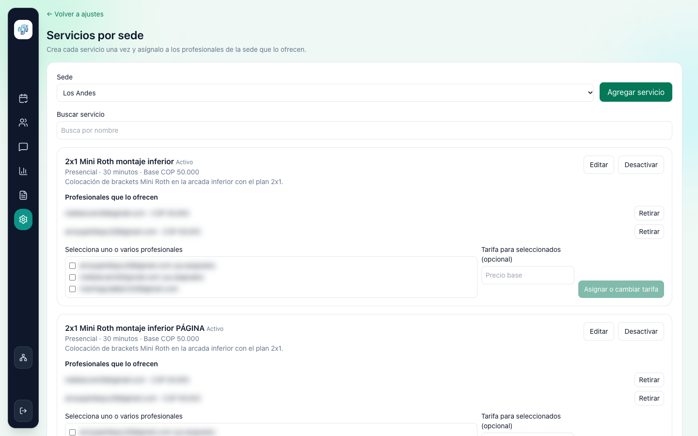

> [!NOTE]
> Cambiar el precio base solo afecta asignaciones nuevas. Las tarifas que ya tienen los profesionales no cambian solas: hay que actualizarlas con **Asignar o cambiar tarifa**.

Con **Editar** cambias los datos del servicio y con **Desactivar** lo ocultas sin borrarlo. **Retirar** le quita el servicio a un profesional.

## 💰 Cobros y paquetes

Por defecto cada cita tiene un servicio y el pago se registra en esa cita. Aquí activas, sede por sede, otras formas de cobrar:

| Opción | Para qué sirve |
|:---|:---|
| **Varios servicios por cita** | Cobrar en una misma cita, por ejemplo, limpieza y resina |
| **Pagos separados y saldo a favor** | Abonos por adelantado o repartidos entre varias citas |
| **Planes y paquetes** | Paquetes de sesiones. Cada cita gasta una sesión en vez de cobrarse de nuevo |
| **Planes por cuotas** | Tratamientos de precio cerrado como la ortodoncia, con cuota inicial y cuotas mensuales. Los controles no generan cobro |

1. Elige la **Sede**.
2. Activa las opciones que necesites.
3. Pulsa **Guardar**.

Para crear un paquete, pulsa **Nuevo paquete**, agrega los servicios con **+ Agregar servicio** y pulsa **Guardar paquete**. El paquete funciona como plantilla: se copia a la cuenta del paciente cuando se lo vendes.

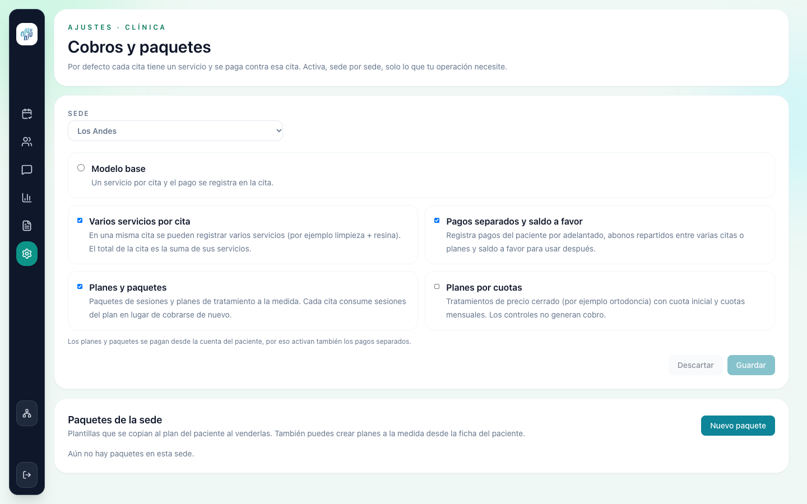

## 📍 Sedes

Muestra las dos sedes con su dirección, ciudad, coordenadas y tipo de consulta.

- **Crear sede** agrega una sede nueva.
- **Editar sede** cambia la dirección o los datos.

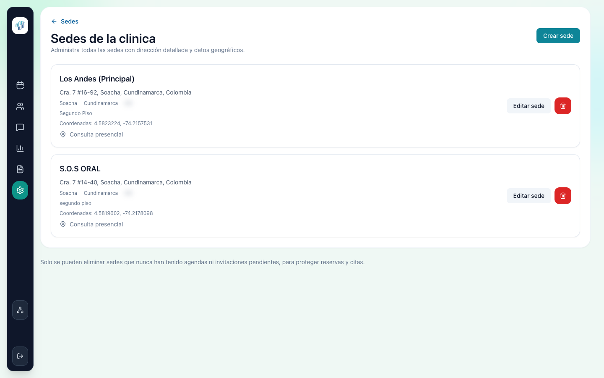

> [!NOTE]
> MeuDoc solo deja eliminar sedes que nunca han tenido agendas ni invitaciones pendientes. Así protege las citas y reservas ya hechas.

## 🏢 Perfil de la clínica

Aquí se edita lo que ven los pacientes en MeuDoc: **Nombre**, **Descripción**, **Sitio web**, **Teléfono** y **Correo** de la clínica.

La casilla **Publicar el perfil de la clínica** hace visibles la clínica, sus profesionales y sus servicios para que los pacientes reserven en línea. Pulsa **Guardar cambios** al terminar.

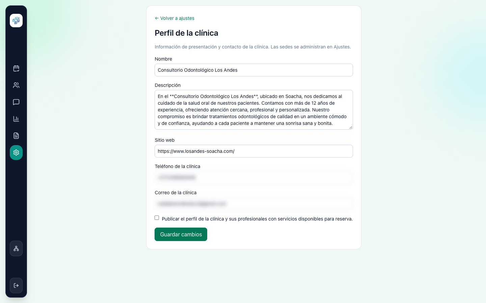

## 📄 Diseños de impresión

Define cómo se ven los resúmenes de citas que se imprimen. El resumen nunca incluye notas privadas y no reemplaza la historia clínica.

Si sale *"No se pudo cargar el diseño o no tienes permiso"*, entra con la cuenta **Owner**.

## 🧾 Facturación electrónica

La primera vez, este módulo no factura todavía. Primero hay que pedirle a MeuDoc que active el servicio.

| Paso | Qué pasa |
|:---:|:---|
| 1 | Pides la activación: eliges **Solo facturación**, **Solo RIPS** o **Facturación y RIPS** |
| 2 | Esperas entre 5 minutos y 8 horas |
| 3 | MeuDoc carga las llaves de facturación por su lado |
| 4 | Aparece **Nuevo documento** y ya puedes facturar |

**Para pedir la activación:**

1. En el menú, abre **Facturación**.
2. Elige el tipo de servicio.
3. Confirma **Nombre o razón social**, **Correo**, **Tipo de documento** (NIT, cédula, cédula de extranjería o pasaporte), **Número** y **Teléfono**.
4. Adjunta el **RUT** en PDF o foto, de máximo 10 MB.
5. Adjunta el PDF de la **Resolución de facturación** o escríbela.
6. Pulsa **Solicitar activación**.

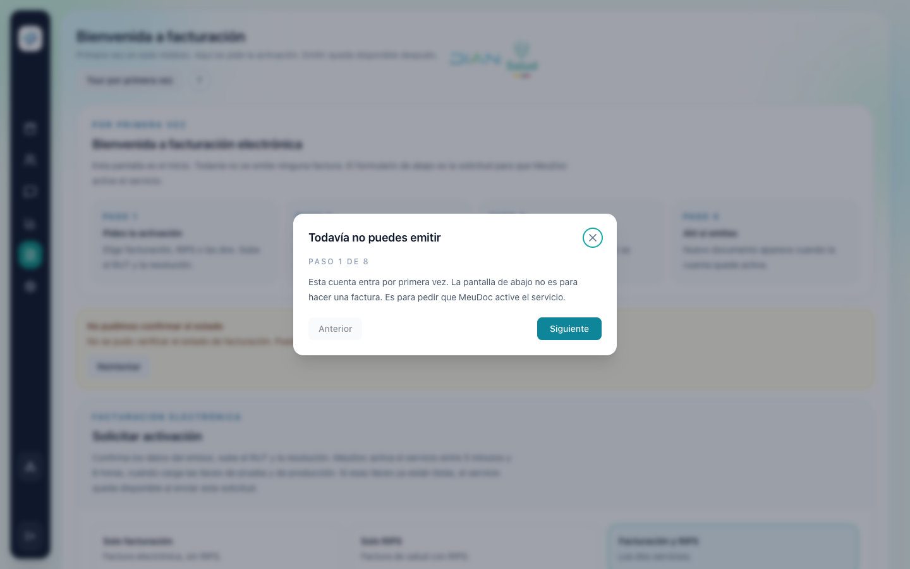

> [!TIP]
> El botón **Tour por primera vez** explica el módulo paso a paso.

## 📈 Reportes completos

El administrador ve todos los informes, incluido **Eficiencia**, que resume citas realizadas, ingresos estimados, reservas en línea, ausencias y los servicios más pedidos.

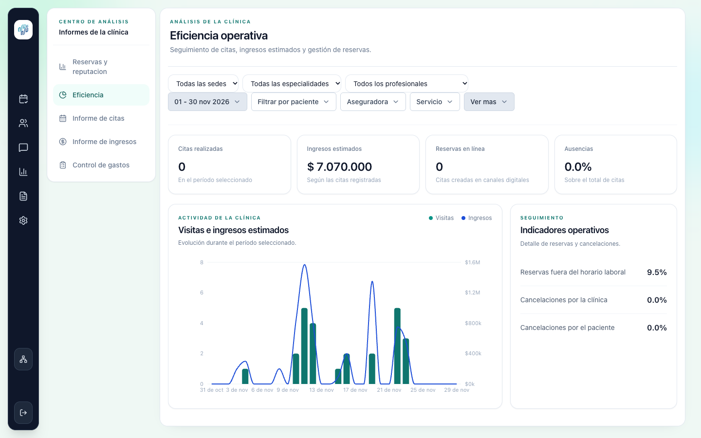

El uso de los filtros y la exportación está en la [guía de recepción](03-recepcionista.md#-reportes).

## ✅ Buenas prácticas

- [ ] Activa la verificación en dos pasos en tu cuenta y pídele lo mismo al equipo.
- [ ] Revisa cada mes la lista de **Usuarios y permisos** y quita a quien ya no trabaje en la clínica.
- [ ] Da a cada recepcionista solo las sedes y los informes que necesita.
- [ ] Mantén al día los horarios de cada agenda para que no se agende fuera de turno.
- [ ] Cuando cambie un precio, actualiza también la tarifa de cada profesional.
- [ ] No compartas la cuenta **Owner**. Cada persona debe tener su propio usuario.

---

<a href="03-recepcionista.md">← Guía de recepción</a> · <a href="../README.md">🏠 Volver al inicio</a>

